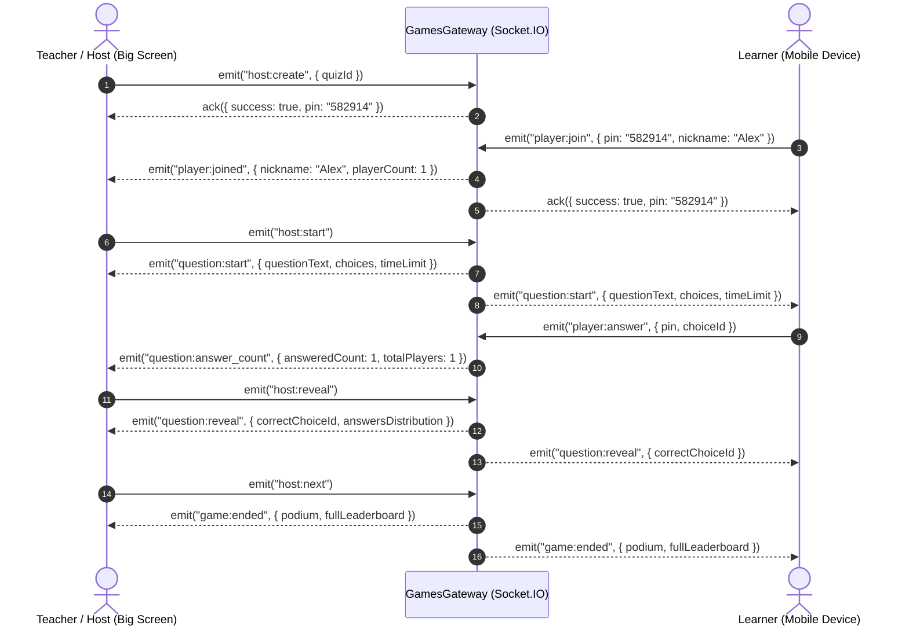

# Kuizu Backend (v2)

[](https://nodejs.org)
[](https://www.typescriptlang.org/)
[](https://nestjs.com/)
[](https://www.mongodb.com/)
[](https://redis.io/)
[](https://socket.io/)
[](https://bullmq.io/)
[](https://vitest.dev/)
[](https://oxc.rs/)
[](https://prettier.io)

An enterprise-grade, production-ready, industry-standard backend engineered for modern gamified learning and real-time multiplayer arena competition (uniting **Duolingo-style quest curricula** with **Kahoot-style big-screen projector battles**). Built with **NestJS 12**, **TypeScript** in strict mode, **Mongoose 9 (MongoDB)**, **Redis 7**, **Socket.IO 4**, and **BullMQ 6**.

---

## Table of Contents

- [Architectural Highlights](#architectural-highlights)
- [System Architecture Diagram](#system-architecture-diagram)
- [Tech Stack](#tech-stack)
- [Project Directory Structure](#project-directory-structure)
- [Prerequisites](#prerequisites)
- [Installation & Getting Started](#installation--getting-started)
- [Environment Configuration](#environment-configuration)
- [Available Scripts](#available-scripts)
- [Security & Authentication Engine](#security--authentication-engine)
  - [Dual-Token Session Rotation & Revocation](#dual-token-session-rotation--revocation)
  - [Role-Based Access Control (RBAC) Matrix](#role-based-access-control-rbac-matrix)
  - [Defense-in-Depth Security Pipeline](#defense-in-depth-security-pipeline)
- [Real-time Multiplayer Arena (Socket.IO)](#real-time-multiplayer-arena-socketio)
  - [WebSocket Gateway Protocol & Event Catalog](#websocket-gateway-protocol--event-catalog)
  - [Distributed State Synchronization & Redis Pub/Sub](#distributed-state-synchronization--redis-pubsub)
- [API Conventions & Querying](#api-conventions--querying)
  - [Pagination Schema & Standard Envelopes](#pagination-schema--standard-envelopes)
  - [Error Response Format](#error-response-format)
- [API Reference](#api-reference)
  - [1. Authentication & Session Management (`/api/v1/auth`)](#1-authentication--session-management-apiv1auth)
  - [2. User Profile & Account Management (`/api/v1/users`)](#2-user-profile--account-management-apiv1users)
  - [3. Gamification Engine (`/api/v1/users`)](#3-gamification-engine-apiv1users)
  - [4. Admin User Management (`/api/v1/admin/users`)](#4-admin-user-management-apiv1adminusers)
  - [5. Course & Curriculum Progression (`/api/v1/courses`)](#5-course--curriculum-progression-apiv1courses)
  - [6. Quiz & Question Bank Catalog (`/api/v1/quizzes`, `/api/v1/questions`)](#6-quiz--question-bank-catalog-apiv1quizzes-apiv1questions)
  - [7. System Health & Kubernetes Probes (`/api/v1/health`)](#7-system-health--kubernetes-probes-apiv1health)
- [Background Processing & Worker Queues (BullMQ)](#background-processing--worker-queues-bullmq)
- [Error Handling & Observability](#error-handling--observability)
- [Testing & Quality Assurance](#testing--quality-assurance)
- [Production Deployment & Containerization](#production-deployment--containerization)
- [License](#license)

---

## Architectural Highlights

- **Clean Modular NestJS Architecture**: Domain-driven encapsulation divided into autonomous modules (`auth`, `users`, `courses`, `quizzes`, `games`, `gamification`, `jobs`, `health`).
- **Data Access Layer with BaseRepository**: Generic repository pattern (`BaseRepository<T>`) encapsulating Mongoose models with support for `.lean()` read-heavy queries and `withTransaction` ACID transactional sessions.
- **Dual-Token JWT Security with Session Revocation**: Access tokens (15m expiration) accompanied by refresh tokens (7d expiration) stored as hashed sessions with remote eviction, logout-all, and device tracking.
- **Real-time Arena WebSocket Gateway**: Low-latency bidirectional gameplay powered by Socket.IO, with room partitioning, live answer distribution charts, Kahoot-formula scoring (time-decay + streak multipliers), and distributed horizontal scaling via `@socket.io/redis-adapter`.
- **Gamification Mechanics**: Automated daily streaks, streak freeze protector consumable, heart depletion/refill mechanics, and weekly tiered competitive leagues (Bronze → Diamond) calculated via background workers.
- **Resilient Background Job Queues (BullMQ)**: Asynchronous processing for transactional verification/reset emails, game report archiving, and league promotion/demotion standings, featuring automated graceful fallback when Redis is offline.
- **Structured Observability**: High-throughput JSON logging with [Pino](https://github.com/pinojs/pino) (`nestjs-pino`), correlation IDs propagated across every HTTP request and worker job, Terminus Kubernetes readiness/liveness probes, and zero-leakage production error filters.

---

## System Architecture Diagram

```mermaid
graph TD
    Client[Next.js 16 Web App / Mobile Gamepad] -->|HTTPS REST| Edge[Edge Proxy / Cloudflare]
    Client -->|WSS Socket.IO| WsGateway[Games WebSocket Gateway]

    subgraph "Kuizu Application Layer"
        Edge --> NestCore[NestJS Core API]
        NestCore --> GlobalGuards[Guards: JwtAuth, Roles, Throttler]
        GlobalGuards --> Controllers[REST Controllers]

        Controllers --> Services[Domain Business Services]
        WsGateway --> GamesService[Games Arena Service]

        Services --> Repositories[Repositories: Course, User, Quiz, Progress]
        GamesService --> GameStateStore[IGameStateStore (Memory / Redis)]
        Services --> BullProducer[BullMQ Jobs Producer]
    end

    subgraph "Infrastructure & Persistence Tier"
        Repositories --> MongoDB[(MongoDB 7.0 Replica Set)]
        BullProducer --> Redis[(Redis 7.2: Cache, Pub/Sub & Queues)]
        GameStateStore -.->|Distributed Sync| Redis
        BullWorkers[BullMQ Workers: Email, GameReports, Gamification] --> Redis
    end
```

---

## Tech Stack

| Layer                   | Technology                                                                                                     | Purpose                                                                     |
| :---------------------- | :------------------------------------------------------------------------------------------------------------- | :-------------------------------------------------------------------------- |
| **Framework**           | [NestJS](https://nestjs.com/) (12.x)                                                                           | Enterprise architectural framework & dependency injection container         |
| **Language & Runtime**  | [TypeScript](https://www.typescriptlang.org/) (5.9) / [Node.js](https://nodejs.org/) (20.x+)                   | Strict static typing, interfaces, and modern asynchronous runtime           |
| **Database**            | [MongoDB](https://www.mongodb.com/) (7.x) via [Mongoose](https://mongoosejs.com/) (9.x)                        | Document-oriented persistence with schema validation & compound indexes     |
| **Cache & Pub/Sub**     | [Redis](https://redis.io/) (7.x) via [ioredis](https://github.com/luin/ioredis) & [Keyv](https://keyv.js.org/) | Distributed cache manager, rate limit storage, and WebSocket adapter        |
| **Realtime Engine**     | [Socket.IO](https://socket.io/) (4.8) & `@socket.io/redis-adapter`                                             | Bidirectional real-time arena battles with room clustering across pods      |
| **Background Jobs**     | [BullMQ](https://bullmq.io/) (6.x)                                                                             | Distributed queue processing for emails, reports, and gamification          |
| **Validation**          | [Zod](https://zod.dev/) (4.x) & NestJS Pipes                                                                   | Strong runtime schema validation for DTOs and environment config            |
| **Auth & Cryptography** | [Passport-JWT](http://www.passportjs.org/), [bcryptjs](https://github.com/dcodeIO/bcrypt.js)                   | Dual-token authentication, hashed passwords, and cryptographic PINs         |
| **Security Suite**      | [Helmet](https://helmetjs.github.io/), CORS, `@nestjs/throttler`                                               | Defense-in-depth protection against XSS, clickjacking, and DDoS/brute-force |
| **Logging & Telemetry** | [Pino](https://getpino.io/) (`nestjs-pino`, `pino-http`, `pino-pretty`)                                        | High-speed structured JSON logging with correlation IDs (`X-Request-Id`)    |
| **Health Checks**       | [NestJS Terminus](https://docs.nestjs.com/recipes/terminus)                                                    | Kubernetes `/health/liveness` and `/health/readiness` probes                |
| **Testing Engine**      | [Vitest](https://vitest.dev/) (4.x) & [Supertest](https://github.com/ladjs/supertest)                          | Blazing-fast unit and end-to-end integration test execution                 |
| **Linter & Formatting** | [oxlint](https://oxc.rs/), [Prettier](https://prettier.io/), [Husky](https://typicode.github.io/husky/)        | High-speed static analysis and git-hook verified code standards             |

---

## Project Directory Structure

```text
kuizu-backend/
├── .github/
│   └── workflows/
│       └── ci.yml             # GitHub Actions CI: Typecheck, Lint, Test, Build
├── .husky/                    # Git pre-commit hooks (lint-staged)
├── dist/                      # Compiled production JavaScript bundle
├── src/
│   ├── common/                # Shared enterprise cross-cutting concerns
│   │   ├── adapters/          # Distributed Redis WebSocket adapter (RedisIoAdapter)
│   │   ├── database/          # BaseRepository<T> with .lean() & withTransaction
│   │   ├── decorators/        # @CurrentUser(), @Public(), @Roles() decorators
│   │   ├── dto/               # Shared pagination DTOs and offset/cursor builders
│   │   ├── filters/           # Global AllExceptionsFilter (production-masked errors)
│   │   ├── guards/            # JwtAuthGuard, RolesGuard
│   │   ├── middleware/        # CorrelationIdMiddleware (UUID request tracing)
│   │   ├── pipes/             # ZodValidationPipe, ParseObjectIdPipe
│   │   ├── redis/             # RedisModule & RedisService (with in-memory fallback)
│   │   ├── throttler/         # RedisThrottlerStorageService
│   │   └── utils/             # Regex sanitization and cryptographic helpers
│   ├── config/                # Environment validation via Zod (env.validation.ts)
│   ├── database/              # Mongoose database module & automatic SeedService
│   ├── modules/               # Domain-driven feature modules
│   │   ├── auth/              # Registration, login, session rotation, password recovery
│   │   ├── courses/           # Courses, units, lesson progress, and XP completion
│   │   ├── games/             # Arena WebSocket Gateway, service, and GameStateStore
│   │   ├── gamification/      # Streaks, heart refills, streak freezes, and leaderboards
│   │   ├── health/            # Terminus health checks (liveness & readiness probes)
│   │   ├── jobs/              # BullMQ queue producer and email/report/league workers
│   │   ├── quizzes/           # Quizzes catalog, questions bank, and tag search
│   │   └── users/             # User profile, session eviction, and admin management
│   ├── app.module.ts          # Root application module with logging, cache, and throttler
│   └── main.ts                # Application bootstrap, Swagger setup, and shutdown hooks
├── test/                      # End-to-End (E2E) test suites with Supertest
│   ├── app.e2e-spec.ts        # Health check and root route tests
│   ├── auth-users.e2e-spec.ts # Full authentication, profile, and admin user tests
│   ├── courses.e2e-spec.ts    # Course curriculum and lesson completion E2E tests
│   └── quizzes.e2e-spec.ts    # Quiz creation, question bank, and visibility tests
├── Dockerfile                 # Multi-stage production container build (Node 22 Alpine)
├── docker-compose.yml         # Container orchestration for App, MongoDB 7, and Redis 7
├── nest-cli.json              # NestJS CLI configuration
├── package.json               # NPM package manifest & scripts
├── tsconfig.json              # Base TypeScript configuration
├── vitest.config.ts           # Vitest configuration for unit tests
└── vitest.config.e2e.ts       # Vitest configuration for E2E integration tests
```

---

## Prerequisites

Ensure your environment satisfies the following requirements:

- **Node.js**: `v20.x` or higher (`v22.x` recommended)
- **Package Manager**: [npm](https://www.npmjs.com/) (`v10.x+`) or [pnpm](https://pnpm.io/)
- **Database**: [MongoDB](https://www.mongodb.com/) (`v6.x` or `v7.x`) or MongoDB Atlas
- **Cache & Message Broker**: [Redis](https://redis.io/) (`v7.x`)
- **Containerization**: [Docker & Docker Compose](https://www.docker.com/) (optional, for local infrastructure)

---

## Installation & Getting Started

### 1. Clone the Repository

```bash
git clone https://github.com/your-username/kuizu-backend.git
cd kuizu-backend
```

### 2. Install Dependencies

```bash
npm install
```

### 3. Setup Environment Variables

Copy `.env.example` to create your local `.env` file:

```bash
cp .env.example .env
```

Review and configure your parameters (see [Environment Configuration](#environment-configuration)).

### 4. Start Infrastructure via Docker Compose (Recommended)

To spin up MongoDB 7.0 and Redis 7.2 locally in detached mode:

```bash
docker compose up -d kuizu-mongo kuizu-redis
```

### 5. Launch the Development Server

```bash
npm run start:dev
```

- **REST API Endpoint**: `http://localhost:4000/api/v1`
- **Swagger Interactive API Documentation**: `http://localhost:4000/api/docs`
- **WebSocket Gateway**: `ws://localhost:4000`

---

## Environment Configuration

Configuration is validated at application startup using strict Zod schemas in `src/config/env.validation.ts`. In `production`, default secrets and localhost URLs trigger startup rejection.

| Variable                 |   Type   | Default                               | Description                                                  | Required |
| :----------------------- | :------: | :------------------------------------ | :----------------------------------------------------------- | :------: |
| `NODE_ENV`               |  `enum`  | `development`                         | Environment mode (`development`, `production`, `test`)       |   Yes    |
| `PORT`                   | `number` | `4000`                                | HTTP port on which the API listens                           |    No    |
| `CLIENT_URL`             | `string` | `http://localhost:3001`               | Primary origin allowed for CORS and cookie dispatch          |   Yes    |
| `CORS_ALLOWED_ORIGINS`   | `string` | _derived_                             | Comma-separated list of allowed CORS origins                 |    No    |
| `MONGODB_URI`            | `string` | `mongodb://127.0.0.1:27017/kuizu`     | MongoDB replica set connection URI                           |   Yes    |
| `REDIS_URI`              | `string` | `redis://127.0.0.1:6379`              | Redis connection string for cache, adapter, & BullMQ         |    No    |
| `JWT_ACCESS_SECRET`      | `string` | `kuizu_super_secret_access_key_2026`  | Secret key for signing access tokens (≥32 chars in prod)     |   Yes    |
| `JWT_REFRESH_SECRET`     | `string` | `kuizu_super_secret_refresh_key_2026` | Secret key for signing refresh tokens (≥32 chars in prod)    |   Yes    |
| `JWT_ACCESS_EXPIRATION`  | `string` | `15m`                                 | Lifetime duration for access tokens                          |    No    |
| `JWT_REFRESH_EXPIRATION` | `string` | `7d`                                  | Lifetime duration for refresh tokens                         |    No    |
| `EXPOSE_DEV_TOKENS`      |  `enum`  | `false`                               | Return verification/reset tokens in response for dev/testing |    No    |
| `ENABLE_SWAGGER`         |  `enum`  | `true`                                | Explicitly enable Swagger documentation in production        |    No    |

---

## Available Scripts

| Command               | Purpose                                                                    |
| :-------------------- | :------------------------------------------------------------------------- |
| `npm run start`       | Launch NestJS application in standard mode                                 |
| `npm run start:dev`   | Start application with hot-reload file watching                            |
| `npm run start:debug` | Launch application in debug mode with V8 inspector                         |
| `npm run start:prod`  | Run compiled production bundle from `dist/main.js`                         |
| `npm run build`       | Compile TypeScript into optimized production output via Nest CLI           |
| `npm run typecheck`   | Perform strict TypeScript compiler validation without output generation    |
| `npm run lint`        | Execute high-speed static analysis across `src/` and `test/` with `oxlint` |
| `npm run format`      | Enforce code style and indentation via Prettier                            |
| `npm test`            | Execute 300+ unit test suites with Vitest in single-run mode               |
| `npm run test:watch`  | Run Vitest in interactive watch mode for TDD workflows                     |
| `npm run test:cov`    | Generate comprehensive V8 code coverage report                             |
| `npm run test:e2e`    | Run complete end-to-end integration tests (`*.e2e-spec.ts`)                |

---

## Security & Authentication Engine

### Dual-Token Session Rotation & Revocation

The platform incorporates an atomic token rotation protocol designed to mitigate stolen session risk:

1. **Access Token (Short-Lived: 15m)**: Signed JWT containing user claims (`sub`, `email`, `role`, `sid`). Accepted via `Authorization: Bearer <token>` header or `access_token` / `kuizu_session` HTTP-only cookies.
2. **Refresh Token (Long-Lived: 7d)**: Cryptographically linked to a `SessionInfo` record in MongoDB storing `tokenHash`, `userAgent`, `ipAddress`, and `expiresAt`.
3. **Atomic Rotation**: Requesting `/api/v1/auth/refresh` consumes the old session and replaces it with a new `sessionId` and `tokenHash`.
4. **Device Management**: Users can inspect active devices via `GET /api/v1/auth/sessions`, revoke individual sessions, or execute remote logout-all (`DELETE /api/v1/auth/sessions?all=true`).

### Role-Based Access Control (RBAC) Matrix

| Endpoint Domain                             | Role: `user` | Role: `teacher` | Role: `admin` |
| :------------------------------------------ | :----------: | :-------------: | :-----------: |
| Self Profile & Account Deletion             |      ✅      |       ✅        |      ✅       |
| Learn Curriculum & Lesson Completion        |      ✅      |       ✅        |      ✅       |
| Multiplayer Arena Player (Join & Play)      |      ✅      |       ✅        |      ✅       |
| Multiplayer Arena Host (Projector Room)     |      ✅      |       ✅        |      ✅       |
| Create & Author Custom Quizzes              |      ✅      |       ✅        |      ✅       |
| Publish / Update Courses & Curricula        |      ❌      |       ✅        |      ✅       |
| Unrestricted Course Inspection (Admin View) |      ❌      |       ✅        |      ✅       |
| Modify User Roles & Account Status          |      ❌      |       ❌        |      ✅       |
| Inspect Global User Management Catalog      |      ❌      |       ❌        |      ✅       |

### Defense-in-Depth Security Pipeline

- **HTTP Security Headers**: Enforced via [Helmet](https://helmetjs.github.io/) with strict Content Security Policy and frameguard protection.
- **Throttler Defense (Redis-Backed)**: Global limit set to 120 req/min, with critical auth endpoints strictly capped at 5 req/min (`register`, `login`, `forgot-password`) to prevent credential stuffing.
- **Zod Runtime Type Safety**: All incoming query parameters, route params, and request bodies pass through `ZodValidationPipe`, stripping unknown properties and halting invalid payloads at the door.
- **Production Error Masking**: `AllExceptionsFilter` catches all operational and runtime exceptions, transforming internal 500 stack traces into generic `"Internal server error"` responses while logging correlation-tagged errors internally.

---

## Real-time Multiplayer Arena (Socket.IO)

The Kuizu Arena enables synchronized classroom/projector gameplay matching Kahoot's competitive dynamics.

### WebSocket Gateway Protocol & Event Catalog



#### Event Catalog

| Event Name              |    Direction     | Payload Schema                                                        | Description                                                         |
| :---------------------- | :--------------: | :-------------------------------------------------------------------- | :------------------------------------------------------------------ |
| `host:create`           | Client → Server  | `{ quizId: string }`                                                  | Host initializes a live room, generating a unique 6-digit PIN       |
| `player:join`           | Client → Server  | `{ pin: string, nickname: string }`                                   | Player enters lobby with PIN and duplicate-checked nickname         |
| `player:joined`         |  Server → Host   | `{ nickname: string, playerCount: number }`                           | Real-time notification of a new connected player                    |
| `player:left`           |  Server → Host   | `{ nickname: string, socketId: string }`                              | Notification when a participant closes their browser or disconnects |
| `host:start`            | Client → Server  | _empty_                                                               | Host transitions room state from `lobby` to first question          |
| `question:start`        |   Server → All   | `{ questionIndex, totalQuestions, questionText, timeLimit, choices }` | Synchronized question launch (answer keys omitted)                  |
| `player:answer`         | Client → Server  | `{ pin: string, choiceId: string }`                                   | Player submits selection before countdown expiration                |
| `question:answer_count` |  Server → Host   | `{ answeredCount: number, totalPlayers: number }`                     | Live progress of submitted answers for projector display            |
| `host:reveal`           | Client → Server  | _empty_                                                               | Host halts timer and exposes results                                |
| `question:reveal`       |   Server → All   | `{ correctChoiceId, answersDistribution, leaderboard }`               | Visual breakdown of correct answers and round standings             |
| `host:next`             | Client → Server  | _empty_                                                               | Host advances to next question or concludes game session            |
| `game:ended`            |   Server → All   | `{ podium: Top3Winner[], fullLeaderboard: PlayerRank[] }`             | Olympic podium ceremony and cumulative score ranks                  |
| `game:cancelled`        | Server → Players | `{ message: string }`                                                 | Emitted to room if host disconnects or leaves                       |

### Distributed State Synchronization & Redis Pub/Sub

To support horizontal auto-scaling across Kubernetes pods:

- **Socket Broadcasting**: Wrapped with `@socket.io/redis-adapter` using Redis Pub/Sub channels (`kuizu-games#*`).
- **State Interface (`IGameStateStore`)**: The arena domain interacts through an abstract interface contract, decoupling gameplay from memory architecture and enabling plug-and-play Redis room stores.

---

## API Conventions & Querying

### Pagination Schema & Standard Envelopes

Endpoints support both **raw collection arrays** (for client simplicity when no pagination is specified) and **paginated metadata envelopes** (when `page` or `limit` is queried):

#### Offset-Based Pagination Query

```http
GET /api/v1/courses?page=1&limit=10&search=japanese&sortOrder=desc
```

#### Paginated Response Envelope

```json
{
  "data": [
    {
      "_id": "66e57bb3e24b4c732c58a101",
      "title": "Japanese for Beginners",
      "slug": "japanese-intro",
      "description": "Master Hiragana, Katakana, and essential conversational grammar.",
      "isPublished": true,
      "units": []
    }
  ],
  "meta": {
    "total": 1,
    "page": 1,
    "limit": 10,
    "totalPages": 1,
    "hasNextPage": false,
    "hasPrevPage": false,
    "nextCursor": null
  }
}
```

### Error Response Format

All errors return a structured JSON contract containing correlation tracking:

```json
{
  "statusCode": 400,
  "timestamp": "2026-10-14T21:30:00.000Z",
  "path": "/api/v1/auth/register",
  "requestId": "e3b0c442-98fc-1c14-9afb-4c7601366281",
  "message": "Username can only contain letters, numbers, and underscores"
}
```

---

## API Reference

### 1. Authentication & Session Management (`/api/v1/auth`)

| Method   | Endpoint                           |    Access     | Rate Limit | Description                                    |
| :------- | :--------------------------------- | :-----------: | :--------: | :--------------------------------------------- |
| `POST`   | `/api/v1/auth/register`            |    Public     | 5 req/min  | Create user profile & dispatch verification    |
| `POST`   | `/api/v1/auth/login`               |    Public     | 5 req/min  | Authenticate credentials & return JWT tokens   |
| `POST`   | `/api/v1/auth/refresh`             |    Public     | 20 req/min | Rotate session & issue new access token        |
| `POST`   | `/api/v1/auth/logout`              | Bearer/Cookie |     —      | Invalidate session & clear auth cookies        |
| `GET`    | `/api/v1/auth/me`                  | Bearer/Cookie |     —      | Retrieve authenticated user profile            |
| `GET`    | `/api/v1/auth/sessions`            | Bearer/Cookie |     —      | List all active sessions with device telemetry |
| `DELETE` | `/api/v1/auth/sessions/:sessionId` | Bearer/Cookie |     —      | Revoke a specific active device session        |
| `DELETE` | `/api/v1/auth/sessions?all=true`   | Bearer/Cookie |     —      | Revoke all other / all active sessions         |
| `POST`   | `/api/v1/auth/change-password`     | Bearer/Cookie | 10 req/min | Update password and invalidate other sessions  |
| `POST`   | `/api/v1/auth/verify-email`        |    Public     | 10 req/min | Verify email address using verification token  |
| `POST`   | `/api/v1/auth/resend-verification` |    Public     | 3 req/min  | Request a new verification email               |
| `POST`   | `/api/v1/auth/forgot-password`     |    Public     | 3 req/min  | Request password reset token                   |
| `POST`   | `/api/v1/auth/reset-password`      |    Public     | 10 req/min | Submit new password using reset token          |

#### Register User Example

```http
POST /api/v1/auth/register
Content-Type: application/json

{
  "username": "duo_master",
  "email": "learner@kuizu.app",
  "password": "SuperSecretPassword123"
}
```

**Response (`201 Created`)**:

```json
{
  "user": {
    "id": "66e57bb3e24b4c732c58a101",
    "email": "learner@kuizu.app",
    "username": "duo_master",
    "role": "user",
    "xp": 0,
    "hearts": 5,
    "gems": 100,
    "streak": { "count": 0, "lastActiveDate": null },
    "league": "bronze"
  },
  "accessToken": "eyJhbGciOiJIUzI1NiIsInR5cCI6IkpXVCJ9...",
  "refreshToken": "eyJhbGciOiJIUzI1NiIsInR5cCI6IkpXVCJ9..."
}
```

---

### 2. User Profile & Account Management (`/api/v1/users`)

| Method   | Endpoint                    |    Access     | Description                           |
| :------- | :-------------------------- | :-----------: | :------------------------------------ |
| `GET`    | `/api/v1/users/profile`     | Bearer/Cookie | Retrieve current user profile         |
| `PATCH`  | `/api/v1/users/profile`     | Bearer/Cookie | Update username or avatar URL         |
| `GET`    | `/api/v1/users/me/progress` | Bearer/Cookie | Retrieve list of completed lesson IDs |
| `DELETE` | `/api/v1/users/me`          | Bearer/Cookie | Permanently delete own user account   |

---

### 3. Gamification Engine (`/api/v1/users`)

| Method | Endpoint                       |    Access     | Description                                            |
| :----- | :----------------------------- | :-----------: | :----------------------------------------------------- |
| `GET`  | `/api/v1/users/leaderboard`    |    Public     | Global leaderboard ranked by XP                        |
| `POST` | `/api/v1/users/activity`       | Bearer/Cookie | Record daily learning streak & evaluate streak freezes |
| `POST` | `/api/v1/users/hearts/refill`  | Bearer/Cookie | Refill hearts to maximum (5) using 50 gems             |
| `POST` | `/api/v1/users/hearts/consume` | Bearer/Cookie | Deduct 1 quest heart on incorrect answer               |
| `POST` | `/api/v1/users/streak-freeze`  | Bearer/Cookie | Purchase a streak freeze protector (100 gems)          |

---

### 4. Admin User Management (`/api/v1/admin/users`)

_All admin endpoints require `Authorization: Bearer <token>` with `role: "admin"`._

| Method   | Endpoint                         | Access | Description                                                  |
| :------- | :------------------------------- | :----: | :----------------------------------------------------------- |
| `GET`    | `/api/v1/admin/users`            | Admin  | Paginated user management table with search and role filters |
| `GET`    | `/api/v1/admin/users/:id`        | Admin  | Inspect full user profile and account details                |
| `PATCH`  | `/api/v1/admin/users/:id/role`   | Admin  | Update user role (`user`, `teacher`, `admin`)                |
| `PATCH`  | `/api/v1/admin/users/:id/status` | Admin  | Suspend or activate user account                             |
| `DELETE` | `/api/v1/admin/users/:id`        | Admin  | Delete user account and revoke all sessions                  |

---

### 5. Course & Curriculum Progression (`/api/v1/courses`)

| Method   | Endpoint                                           |     Access      | Description                                              |
| :------- | :------------------------------------------------- | :-------------: | :------------------------------------------------------- |
| `GET`    | `/api/v1/courses`                                  |     Public      | List all published courses (or paginated when queried)   |
| `GET`    | `/api/v1/courses/:slug`                            |     Public      | Retrieve course structure and units by slug              |
| `GET`    | `/api/v1/courses/:slug/curriculum`                 |     Bearer      | Get curriculum enriched with user completed/locked state |
| `GET`    | `/api/v1/courses/:slug/lessons/:lessonId`          |     Public      | Retrieve exercise payloads for a specific lesson         |
| `GET`    | `/api/v1/courses/:slug/progress`                   |     Bearer      | Get user progress percentage and completed lesson IDs    |
| `POST`   | `/api/v1/courses/:slug/lessons/:lessonId/complete` |     Bearer      | Complete lesson, award 20 XP, and save progress          |
| `GET`    | `/api/v1/courses/admin/all`                        | Teacher / Admin | List all courses including draft/unpublished             |
| `POST`   | `/api/v1/courses`                                  | Teacher / Admin | Create a new curriculum course                           |
| `PUT`    | `/api/v1/courses/:id`                              | Teacher / Admin | Update course metadata, units, and lessons               |
| `DELETE` | `/api/v1/courses/:id`                              | Teacher / Admin | Delete course                                            |

---

### 6. Quiz & Question Bank Catalog (`/api/v1/quizzes`, `/api/v1/questions`)

| Method   | Endpoint                | Access | Description                                                |
| :------- | :---------------------- | :----: | :--------------------------------------------------------- |
| `GET`    | `/api/v1/quizzes`       | Public | Search and list public multiplayer quizzes                 |
| `GET`    | `/api/v1/quizzes/my`    | Bearer | List quizzes created by authenticated user                 |
| `GET`    | `/api/v1/quizzes/:id`   | Public | Get quiz by ID (answer keys sanitized for public learners) |
| `POST`   | `/api/v1/quizzes`       | Bearer | Create a new multiplayer quiz deck                         |
| `PUT`    | `/api/v1/quizzes/:id`   | Bearer | Update quiz (author or admin verified)                     |
| `DELETE` | `/api/v1/quizzes/:id`   | Bearer | Delete quiz                                                |
| `POST`   | `/api/v1/questions`     | Bearer | Add question to question bank                              |
| `GET`    | `/api/v1/questions/:id` | Bearer | Get specific question details                              |
| `PUT`    | `/api/v1/questions/:id` | Bearer | Update question choices, points, or time limit             |
| `DELETE` | `/api/v1/questions/:id` | Bearer | Delete question                                            |

---

### 7. System Health & Kubernetes Probes (`/api/v1/health`)

| Method | Endpoint                   | Access | Description                                                    |
| :----- | :------------------------- | :----: | :------------------------------------------------------------- |
| `GET`  | `/api/v1/health`           | Public | Return server status, process uptime, and database status      |
| `GET`  | `/api/v1/health/liveness`  | Public | Kubernetes liveness probe (process PID & health)               |
| `GET`  | `/api/v1/health/readiness` | Public | Kubernetes readiness probe (MongoDB & Redis ping verification) |

---

## Background Processing & Worker Queues (BullMQ)

Asynchronous workflows are handled via BullMQ queue workers backed by Redis:

1. **`email-queue` ([`EmailProcessor`](src/modules/jobs/processors/email.processor.ts))**:
   - Delivers account email verification links and password recovery tokens.
2. **`game-reports-queue` ([`GameReportsProcessor`](src/modules/jobs/processors/game-reports.processor.ts))**:
   - Persists completed live arena battle sessions and increments quiz play metrics.
3. **`gamification-queue` ([`GamificationProcessor`](src/modules/jobs/processors/gamification.processor.ts))**:
   - Calculates weekly tiered league standings, promoting top 20% to higher tier and demoting bottom 20%.

_In environments without Redis configured, the producer seamlessly executes an in-process fallback to maintain operational continuity._

---

## Error Handling & Observability

- **Structured Pino Logging**: Integrated through `nestjs-pino`. All logs output JSON format with correlation IDs (`x-request-id`, `x-correlation-id`) matching between incoming HTTP requests and outgoing responses.
- **Sensitive Field Redaction**: Automatically censors authorization tokens, cookies, and password fields in HTTP payloads.
- **Global AllExceptionsFilter**: Catches all errors, formats MongoDB unique key collisions (`11000`) and Mongoose `CastError` into clean 400/409 codes, and masks internal server errors in production.
- **Kubernetes Probes**: Native Terminus health checks at `/api/v1/health/liveness` and `/api/v1/health/readiness`.

---

## Testing & Quality Assurance

The codebase maintains **100% test passing health** with 330+ tests across unit and end-to-end suites powered by [Vitest](https://vitest.dev/):

```bash
# Run all unit tests
npm test

# Run tests in interactive watch mode
npm run test:watch

# Run end-to-end integration tests
npm run test:e2e

# Run with V8 code coverage
npm run test:cov
```

### Test Coverage Highlights

- **Auth Service & Strategy Suites (`auth.service.spec.ts`, `jwt.strategy.spec.ts`)**: Validates password hashing, token issuance, session rotation, session eviction, email verification, and multi-cookie extraction.
- **Arena & Socket Gateway Suites (`games.gateway.spec.ts`, `games.service.spec.ts`, `game-state.store.spec.ts`)**: Validates room PIN generation, duplicate nickname prevention, synchronized countdowns, speed-scoring bonuses, streak tracking, and answer distribution.
- **Curriculum & Gamification Suites (`courses.service.spec.ts`, `gamification.service.spec.ts`)**: Validates unit unlocked progression, XP reward calculation, heart consumption, and daily streak freeze preservation.
- **E2E Suites (`test/*.e2e-spec.ts`)**: Validates live HTTP requests against controllers with Supertest.

---

## Production Deployment & Containerization

### 1. Build and Run via Docker Compose

```bash
# Build and start all services (Backend, MongoDB, Redis)
docker compose up -d --build

# View real-time aggregated logs
docker compose logs -f kuizu-backend
```

### 2. Multi-Stage Dockerfile Compilation

The application uses an optimized multi-stage [Dockerfile](Dockerfile) with `node:22-alpine`, pruning devDependencies and running as an unprivileged `node` user:

```bash
docker build -t kuizu-backend:latest .
docker run -p 4000:4000 --env-file .env kuizu-backend:latest
```

---

## License

This project is licensed under the [ISC License](LICENSE).
